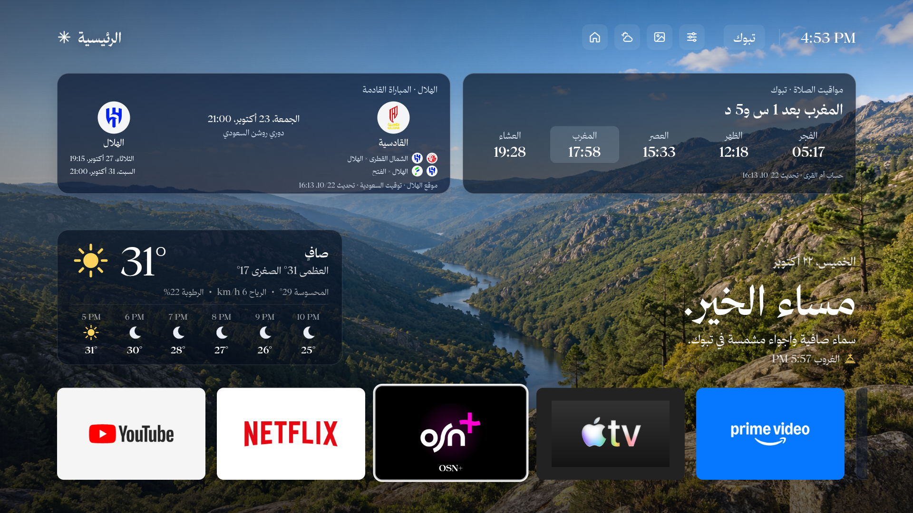
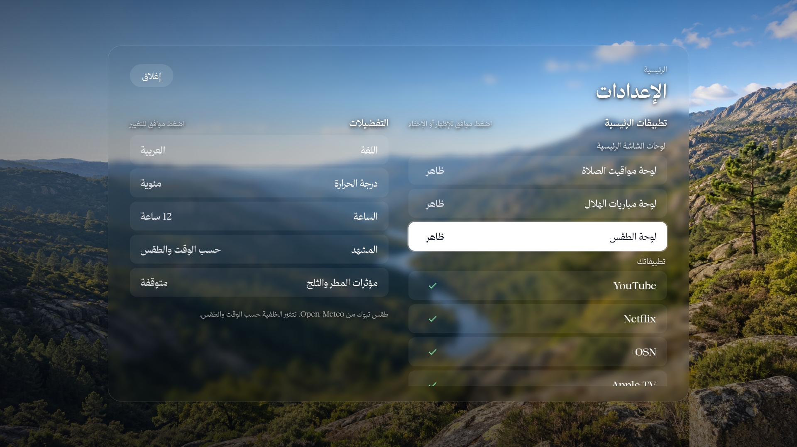

<div dir="rtl">

# Custom TV Arabic 📺

واجهة عربية قابلة للتخصيص لأجهزة **Android TV / Google TV**: تطبيقاتك، مواقيت الصلاة، الطقس، ومباريات فريقك مع شعارات الأندية، مع **تنظيف اختياري قابل للاستعادة**.

**انسخ رابط المستودع وأعطه لأيجنت يعمل على حاسوبك.** سيقرأ تعليمات الإعداد، ويسألك عن مدينتك وفريقك وتطبيقاتك، ثم يبني نسختك ويثبتها على التلفزيون بعد التحقق من الجهاز.

## ابدأ بهذه الرسالة

> أريد إعداد هذا المشروع على تلفزيوني: https://github.com/TurkiHassan/custom-tv-arabic
>
> اقرأ AGENTS.md ثم docs/AGENT_SETUP.md. اسألني عن مدينتي وفريقي المفضل والتطبيقات واللوحات التي أريدها، وهل أرغب في تنظيف التطبيقات المقترحة ومنع السكون. افحص التلفزيون، واعرض خطة التنظيف قبل تنفيذها، واحتفظ بنسخة لاستعادة الإعدادات.

يتطلب التنفيذ أيجنت لديه وصول محلي للطرفية والشبكة، وحاسوبًا متصلًا بشبكة التلفزيون أو بكابل USB مناسب. المحادثة السحابية وحدها لا تتصل بتلفزيون المنزل دون جسر محلي. ستحتاج إلى تفعيل التصحيح وقبول السماح على التلفزيون عند طلبه.

## صور الواجهة

الصور من النسخة المخصصة **لتبوك والهلال**، بخط **ثمانية Display** المضاف محليًا. الخط غير مرفق في المستودع؛ النسخة العامة تستخدم خط النظام إلى أن تضيف خطًا مرخصًا لك.





## ما الذي يتضمنه؟

- واجهة عربية تدعم الريموت واتجاه القراءة من اليمين إلى اليسار.
- مواقيت الصلاة بحسب المدينة والمنطقة الزمنية وطريقة الحساب المختارة.
- مباريات الهلال من موقع النادي الرسمي؛ وفرق أخرى عبر ESPN بحسب الدوريات المتاحة التي يحددها الإعداد.
- شعارات الأندية عند توفرها من المصدر، وأيقونات التطبيقات المثبتة بحجم متوازن داخل الإطارات.
- الطقس وخلفيات بحسب الحالة، وإعدادات مستقلة لإخفاء أو إظهار **الصلاة والمباريات والطقس**.
- ساعة محيطية تُفتح يدويًا؛ ليست شاشة توقف تلقائية مسجلة لدى النظام.
- تنظيف محافظ يعطل الحزم المختارة دون إزالتها، مع سجل استعادة. القائمة المرفقة تشمل الحزمتين اللتين جُرب تعطيلهما في تجهيز IMPEX/Expressluck؛ ليست قائمة عامة لكل الماركات.
- خيار مستقل لمنع السكون أثناء توصيل الكهرباء، مع حفظ القيم السابقة.

## التثبيت اليدوي

المتطلبات: **Python 3.10+، JDK 17، Android SDK 34 وBuild Tools، ADB**. اجعل `ANDROID_HOME` يشير إلى SDK، وضع `platform-tools` في `PATH`. لا تحتاج إلى Android Studio إذا كانت أدوات SDK متوفرة. على Windows استخدم `gradlew.bat`، وثبّت `tzdata` إذا لم تتوفر قاعدة المناطق الزمنية.

</div>

```sh
git clone https://github.com/TurkiHassan/custom-tv-arabic.git
cd custom-tv-arabic
cp profiles/example.json profiles/my.local.json
# عدّل المدينة والفريق والتطبيقات في ملفك المحلي
python3 scripts/configure.py --profile profiles/my.local.json
./gradlew --no-daemon testDebugUnitTest lintDebug assembleDebug
adb connect TV_IP:PORT
python3 scripts/tv.py --device TV_IP:PORT inspect
python3 scripts/tv.py --device TV_IP:PORT --serial HARDWARE_SERIAL install --apk app/build/outputs/apk/debug/app-debug.apk
# بعد التأكد من العرض والريموت، اجعلها الرئيسية:
python3 scripts/tv.py --device TV_IP:PORT --serial HARDWARE_SERIAL make-home
```

<div dir="rtl">

استبدل `TV_IP:PORT` بالعنوان المعروض على جهازك، و`HARDWARE_SERIAL` بالرقم الذي يعرضه الفحص بعد تأكيد أنه تلفزيونك. في التصحيح اللاسلكي الحديث استخدم `adb pair` أولًا، ثم عنوان الاتصال الذي قد يختلف عن عنوان الاقتران. لا تفترض أن المنفذ 5555 مفتوح بمجرد تفعيل تصحيح USB.

[دليل الإعداد الكامل للأيجنت](docs/AGENT_SETUP.md) · [التنظيف والاستعادة](docs/CLEANUP.md) · [المصادر والحدود](docs/SOURCES.md)

## خط ثمانية Display

نزّل الخط بنفسك من [موقع خط ثمانية الرسمي](https://font.thmanyah.com/)، واقرأ ترخيصه. لا نعيد توزيع الملفات الخام ولا نرفق APK يحتويها. للاستعمال المحلي، إذا كان ترخيصك يسمح بذلك:

</div>

```sh
python3 scripts/import_font.py --directory /path/to/your/licensed/font-folder
./gradlew assembleDebug
```

<div dir="rtl">

ملفات الخط مستبعدة من Git. لا ترفع نسخة APK أو مصدر يتضمن الخط دون إذن مناسب. الصور المعروضة توضح المظهر عند إضافته محليًا.

## التحقق والتوافق

التجهيز الأصلي جُرب على IMPEX evoQ 4K، Android 11. النسخة العامة تستهدف Android 8 فأحدث، وتتطلب التحقق على كل جهاز؛ بعض الشركات تقيد استبدال الشاشة الرئيسية أو التصحيح. لا يدعم هذا المشروع Tizen أو webOS. بعض خدمات HDMI والطاقة تختلف بين الشركات.

</div>

```sh
python3 -m unittest discover -s scripts -p 'test_*.py'
node --test web-tests/*.test.cjs
./gradlew testDebugUnitTest testReleaseUnitTest lintDebug lintRelease assembleDebug assembleRelease
```

<div dir="rtl">

بناء `release` هنا يستخدم مفتاح التطوير المحلي لتسهيل التجربة الشخصية؛ ليس إصدار متجر موقّعًا للنشر التجاري. احتفظ بمفتاحك محليًا للتحديثات اللاحقة، ولا ترفعه للمستودع.

## الشكر والترخيص

الواجهة مستندة إلى [berteotti/custom-tv](https://github.com/berteotti/custom-tv)، مع استفادة من [Gathin23/cleanyourtv](https://github.com/Gathin23/cleanyourtv). التعديلات العربية وتكامل Android والتخصيص وأدوات التنظيف موثقة في هذا المستودع. نحتفظ بحقوق أصحاب العمل الأصلي؛ راجع [إشعارات الأطراف الأخرى](THIRD_PARTY_NOTICES.md) والتراخيص المرفقة.

</div>
